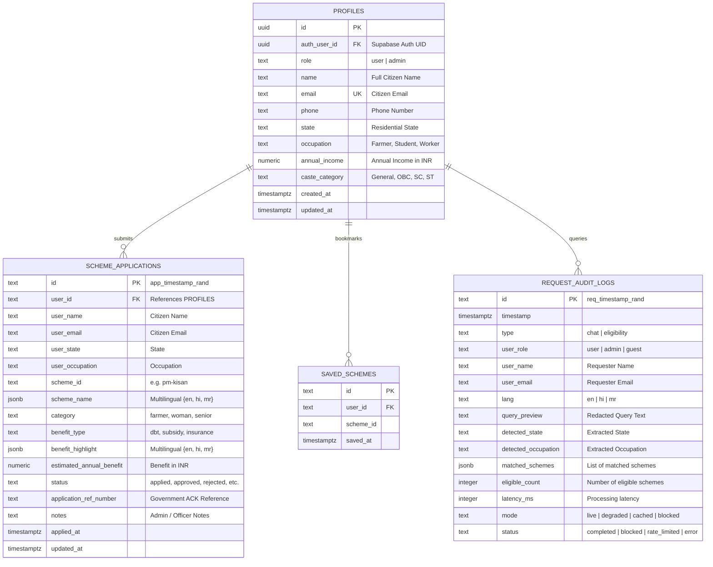

# YojanaMitra — Supabase & PostgreSQL Database Architecture & Query Guide

This document is the complete, line-by-line technical specification for transitioning **YojanaMitra** from its zero-database in-memory/file storage to a persistent **Supabase (PostgreSQL)** database.

---

## Table of Contents
1. [Architectural Overview & Design Principles](#1-architectural-overview--design-principles)
2. [Database Entity-Relationship Diagram (ERD)](#2-database-entity-relationship-diagram-erd)
3. [DDL: Database Tables (Line-by-Line Explanation)](#3-ddl-database-tables-line-by-line-explanation)
   - [3.1 Profiles Table (`profiles`)](#31-profiles-table-profiles)
   - [3.2 Citizen Applications Table (`scheme_applications`)](#32-citizen-applications-table-scheme_applications)
   - [3.3 AI Query Audit Stream Table (`request_audit_logs`)](#33-ai-query-audit-stream-table-request_audit_logs)
   - [3.4 Citizen Saved Bookmarks Table (`saved_schemes`)](#34-citizen-saved-bookmarks-table-saved_schemes)
4. [Performance Indexes (Line-by-Line Explanation)](#4-performance-indexes-line-by-line-explanation)
5. [Row Level Security (RLS) Policies (Line-by-Line Explanation)](#5-row-level-security-rls-policies-line-by-line-explanation)
6. [Production SQL Queries (One-to-One Line Explanations)](#6-production-sql-queries-one-to-one-line-explanations)
   - [Query 1: Citizen View — Fetch My Active Applications](#query-1-citizen-view--fetch-my-active-applications)
   - [Query 2: Admin Dashboard — Which User Applied for Which Scheme](#query-2-admin-dashboard--which-user-applied-for-which-scheme)
   - [Query 3: Benefit Analytics — Top Schemes Delivering Maximum Financial Welfare](#query-3-benefit-analytics--top-schemes-delivering-maximum-financial-welfare)
   - [Query 4: Demand Analytics — Top Schemes by Application Volume](#query-4-demand-analytics--top-schemes-by-application-volume)
   - [Query 5: Demographics — Total Welfare Value by Citizen Category](#query-5-demographics--total-welfare-value-by-citizen-category)
   - [Query 6: KPI Totals — Potential vs. Realized DBT Cash Outflow](#query-6-kpi-totals--potential-vs-realized-dbt-cash-outflow)
   - [Query 7: Admin Workflow — Update Application Status & Record Officer Notes](#query-7-admin-workflow--update-application-status--record-officer-notes)
   - [Query 8: AI Stream — Query Latency & Multilingual Breakdown (MR/HI/EN)](#query-8-ai-stream--query-latency--multilingual-breakdown-mr-hi-en)
   - [Query 9: Security Audit — Flag Blocked & Rate-Limited Injections](#query-9-security-audit--flag-blocked--rate-limited-injections)
   - [Query 10: Demand Gap — Identify Top Welfare Queries with Zero Scheme Matches](#query-10-demand-gap--identify-top-welfare-queries-with-zero-scheme-matches)
7. [Step-by-Step Supabase Migration Plan](#7-step-by-step-supabase-migration-plan)

---

## 1. Architectural Overview & Design Principles

YojanaMitra employs the **Repository / Store Pattern**:
- **Interface Segregation**: The Next.js API routes consume TypeScript interfaces (`ApplicationStore`, `RequestLogStore`) rather than raw database drivers.
- **Dual-Mode Adapter**:
  - **Local Mode (Default)**: Uses fast in-memory buffers + atomic JSON file writes. No external services or keys needed.
  - **Cloud Mode (Supabase)**: Activates automatically when `NEXT_PUBLIC_SUPABASE_URL` and `SUPABASE_SERVICE_ROLE_KEY` are populated in `.env.local`.
- **Zero-Downtime Migration**: The system can migrate records from local JSON files to Supabase using a one-time migration script.

---

## 2. Database Entity-Relationship Diagram (ERD)



---

## 3. DDL: Database Tables (Line-by-Line Explanation)

### 3.1 Profiles Table (`profiles`)

Stores citizen and administrator account information.

```sql
CREATE TABLE IF NOT EXISTS public.profiles (
  id UUID PRIMARY KEY DEFAULT gen_random_uuid(),
  auth_user_id UUID REFERENCES auth.users(id) ON DELETE CASCADE,
  role TEXT NOT NULL DEFAULT 'user' CHECK (role IN ('user', 'admin')),
  name TEXT NOT NULL,
  email TEXT NOT NULL UNIQUE,
  phone TEXT,
  state TEXT,
  occupation TEXT,
  annual_income NUMERIC(12, 2) DEFAULT 0,
  caste_category TEXT,
  created_at TIMESTAMPTZ NOT NULL DEFAULT NOW(),
  updated_at TIMESTAMPTZ NOT NULL DEFAULT NOW()
);
```

#### Line-by-Line Breakdown:
- **`CREATE TABLE IF NOT EXISTS public.profiles (`**: Creates the table safely without throwing an error if it already exists.
- **`id UUID PRIMARY KEY DEFAULT gen_random_uuid(),`**: Generates a cryptographically secure UUIDv4 primary key for each profile.
- **`auth_user_id UUID REFERENCES auth.users(id) ON DELETE CASCADE,`**: Links directly to Supabase's built-in authentication system (`auth.users`). If a user is deleted from auth, their profile is automatically cleaned up (`CASCADE`).
- **`role TEXT NOT NULL DEFAULT 'user' CHECK (role IN ('user', 'admin')),`**: Enforces strict Role-Based Access Control (RBAC). Only `'user'` (citizen) or `'admin'` (welfare officer) are allowed.
- **`name TEXT NOT NULL,`**: Full name of the citizen, required for applications and official documents.
- **`email TEXT NOT NULL UNIQUE,`**: Email address, constrained as unique across all accounts to prevent duplicates.
- **`phone TEXT,`**: Optional citizen phone number for SMS and Direct Benefit Transfer (DBT) updates.
- **`state TEXT,`**: Citizen's state of domicile (e.g., `"Maharashtra"`), critical for determining state-specific welfare eligibility.
- **`occupation TEXT,`**: Livelihood (e.g., `"Farmer"`, `"Student"`, `"Construction Worker"`), essential for scheme targeting.
- **`annual_income NUMERIC(12, 2) DEFAULT 0,`**: Exact family income in Indian Rupees (INR) with 2 decimal precision, tested against scheme income ceilings.
- **`caste_category TEXT,`**: Social category (`"General"`, `"OBC"`, `"SC"`, `"ST"`), required for quota and scholarship rules.
- **`created_at TIMESTAMPTZ NOT NULL DEFAULT NOW(),`**: Automatic UTC timestamp when the user registered.
- **`updated_at TIMESTAMPTZ NOT NULL DEFAULT NOW()`**: Automatic UTC timestamp updated on every profile edit.

---

### 3.2 Citizen Applications Table (`scheme_applications`)

Stores every citizen's scheme applications, tracking status, benefit value, and government reference numbers.

```sql
CREATE TABLE IF NOT EXISTS public.scheme_applications (
  id TEXT PRIMARY KEY,
  user_id TEXT NOT NULL,
  user_name TEXT NOT NULL,
  user_email TEXT NOT NULL,
  user_state TEXT,
  user_occupation TEXT,
  scheme_id TEXT NOT NULL,
  scheme_name JSONB NOT NULL,
  category TEXT NOT NULL,
  benefit_type TEXT NOT NULL,
  benefit_highlight JSONB NOT NULL,
  estimated_annual_benefit NUMERIC(12, 2) NOT NULL DEFAULT 0,
  status TEXT NOT NULL DEFAULT 'applied' CHECK (
    status IN ('applied', 'under_review', 'approved', 'benefit_received', 'rejected')
  ),
  application_ref_number TEXT,
  notes TEXT,
  applied_at TIMESTAMPTZ NOT NULL DEFAULT NOW(),
  updated_at TIMESTAMPTZ NOT NULL DEFAULT NOW()
);
```

#### Line-by-Line Breakdown:
- **`id TEXT PRIMARY KEY,`**: Unique application identifier matching YojanaMitra's format (e.g., `app_179515289_a4f9`).
- **`user_id TEXT NOT NULL,`**: Identifier of the applicant citizen.
- **`user_name TEXT NOT NULL,`**: Citizen's name snapshot at time of application submission.
- **`user_email TEXT NOT NULL,`**: Citizen's contact email.
- **`user_state TEXT,`**: Applicant's residential state (e.g. Maharashtra).
- **`user_occupation TEXT,`**: Applicant's verified occupation.
- **`scheme_id TEXT NOT NULL,`**: Canonical scheme identifier from `/data/schemes/` (e.g., `pm-kisan`, `maharashtra-ladki-bahin`).
- **`scheme_name JSONB NOT NULL,`**: Multilingual scheme titles stored as JSONB (`{"en": "...", "hi": "...", "mr": "..."}`) for zero-translation latency.
- **`category TEXT NOT NULL,`**: Target welfare category (`farmer`, `woman`, `student`, `senior_citizen`, `worker`, `disability`).
- **`benefit_type TEXT NOT NULL,`**: Mechanism of assistance (`dbt`, `subsidy`, `insurance`, `loan`, `pension`, `scholarship`).
- **`benefit_highlight JSONB NOT NULL,`**: Trilingual short summary of financial benefit (e.g., `{"en": "₹6,000 / year via Direct Benefit Transfer"}`).
- **`estimated_annual_benefit NUMERIC(12, 2) NOT NULL DEFAULT 0,`**: The quantified yearly rupee value of the welfare program (e.g., `6000.00` for PM-Kisan, `18000.00` for Ladki Bahin, `500000.00` for Ayushman Bharat).
- **`status TEXT NOT NULL DEFAULT 'applied' CHECK (...),`**: State-machine constraint ensuring status is strictly one of:
  - `applied`: Submitted by citizen.
  - `under_review`: Document verification in progress by welfare officer.
  - `approved`: Formally approved for entitlement.
  - `benefit_received`: DBT funds credited to citizen's Aadhaar-linked bank account.
  - `rejected`: Application rejected with justification.
- **`application_ref_number TEXT,`**: Official acknowledgment or sanction number (e.g., `MH-LAK-2026-88412`).
- **`notes TEXT,`**: Welfare officer comments and citizen instructions.
- **`applied_at TIMESTAMPTZ NOT NULL DEFAULT NOW(),`**: Exact timestamp when application was initiated.
- **`updated_at TIMESTAMPTZ NOT NULL DEFAULT NOW()`**: Timestamp of the latest status modification.

---

### 3.3 AI Query Audit Stream Table (`request_audit_logs`)

Maintains an immutable, privacy-compliant audit log of every user interaction with the AI assistant.

```sql
CREATE TABLE IF NOT EXISTS public.request_audit_logs (
  id TEXT PRIMARY KEY,
  timestamp TIMESTAMPTZ NOT NULL DEFAULT NOW(),
  type TEXT NOT NULL CHECK (type IN ('chat', 'eligibility')),
  user_role TEXT NOT NULL CHECK (user_role IN ('user', 'admin', 'guest')),
  user_name TEXT NOT NULL,
  user_email TEXT NOT NULL,
  lang TEXT NOT NULL CHECK (lang IN ('en', 'hi', 'mr')),
  query_preview TEXT NOT NULL,
  detected_state TEXT,
  detected_occupation TEXT,
  matched_schemes JSONB NOT NULL DEFAULT '[]'::JSONB,
  eligible_count INT NOT NULL DEFAULT 0,
  latency_ms INT NOT NULL DEFAULT 0,
  mode TEXT NOT NULL CHECK (mode IN ('live', 'degraded', 'cached', 'blocked')),
  status TEXT NOT NULL CHECK (status IN ('completed', 'blocked', 'rate_limited', 'error'))
);
```

#### Line-by-Line Breakdown:
- **`id TEXT PRIMARY KEY,`**: Unique request audit token (e.g., `req_179515289_b87c`).
- **`timestamp TIMESTAMPTZ NOT NULL DEFAULT NOW(),`**: Exact time the query hit the server.
- **`type TEXT NOT NULL CHECK (type IN ('chat', 'eligibility')),`**: Channel used: conversational RAG chat or structured eligibility wizard.
- **`user_role TEXT NOT NULL CHECK (...),`**: Role of the requester (`user`, `admin`, or unauthenticated `guest`).
- **`user_name TEXT NOT NULL,`**: Display name of the user.
- **`user_email TEXT NOT NULL,`**: Email address of the user.
- **`lang TEXT NOT NULL CHECK (lang IN ('en', 'hi', 'mr')),`**: Language of the interaction (`en` = English, `hi` = Hindi, `mr` = Marathi).
- **`query_preview TEXT NOT NULL,`**: PII-redacted snippet of the user's question.
- **`detected_state TEXT,`**: State detected by the NLU entity extractor.
- **`detected_occupation TEXT,`**: Occupation detected by the NLU entity extractor.
- **`matched_schemes JSONB NOT NULL DEFAULT '[]'::JSONB,`**: Array of scheme IDs, titles, and match status returned by the hybrid RAG engine.
- **`eligible_count INT NOT NULL DEFAULT 0,`**: Total number of schemes where the citizen qualified.
- **`latency_ms INT NOT NULL DEFAULT 0,`**: Round-trip processing time in milliseconds.
- **`mode TEXT NOT NULL CHECK (...),`**: Execution mode (`live` RAG, `cached` LRU response, `degraded` keyword fallback, or `blocked` prompt guard).
- **`status TEXT NOT NULL CHECK (...),`**: Final HTTP outcome (`completed`, `blocked`, `rate_limited`, or `error`).

---

### 3.4 Citizen Saved Bookmarks Table (`saved_schemes`)

Stores schemes bookmarked by citizens for offline reading or printing document checklists.

```sql
CREATE TABLE IF NOT EXISTS public.saved_schemes (
  id UUID PRIMARY KEY DEFAULT gen_random_uuid(),
  user_id TEXT NOT NULL,
  scheme_id TEXT NOT NULL,
  saved_at TIMESTAMPTZ NOT NULL DEFAULT NOW(),
  CONSTRAINT uq_user_scheme UNIQUE (user_id, scheme_id)
);
```

#### Line-by-Line Breakdown:
- **`id UUID PRIMARY KEY DEFAULT gen_random_uuid(),`**: Unique bookmark entry identifier.
- **`user_id TEXT NOT NULL,`**: Citizen who saved the scheme.
- **`scheme_id TEXT NOT NULL,`**: ID of the saved welfare scheme.
- **`saved_at TIMESTAMPTZ NOT NULL DEFAULT NOW(),`**: Timestamp when the scheme was saved.
- **`CONSTRAINT uq_user_scheme UNIQUE (user_id, scheme_id)`**: Prevents duplicate bookmark rows for the same user and scheme.

---

## 4. Performance Indexes (Line-by-Line Explanation)

```sql
-- Applications table indexes
CREATE INDEX IF NOT EXISTS idx_scheme_apps_user ON public.scheme_applications(user_id);
CREATE INDEX IF NOT EXISTS idx_scheme_apps_scheme ON public.scheme_applications(scheme_id);
CREATE INDEX IF NOT EXISTS idx_scheme_apps_status ON public.scheme_applications(status);
CREATE INDEX IF NOT EXISTS idx_scheme_apps_category ON public.scheme_applications(category);
CREATE INDEX IF NOT EXISTS idx_scheme_apps_applied_at ON public.scheme_applications(applied_at DESC);

-- Request audit stream indexes
CREATE INDEX IF NOT EXISTS idx_audit_timestamp ON public.request_audit_logs(timestamp DESC);
CREATE INDEX IF NOT EXISTS idx_audit_type ON public.request_audit_logs(type);
CREATE INDEX IF NOT EXISTS idx_audit_lang ON public.request_audit_logs(lang);
CREATE INDEX IF NOT EXISTS idx_audit_status ON public.request_audit_logs(status);
```

#### Line-by-Line Breakdown:
- **`CREATE INDEX IF NOT EXISTS idx_scheme_apps_user ON public.scheme_applications(user_id);`**: Speeds up the Citizen Portal (`WHERE user_id = $1`) from a full table scan to an index lookup ($O(\log N)$).
- **`CREATE INDEX IF NOT EXISTS idx_scheme_apps_scheme ON public.scheme_applications(scheme_id);`**: Accelerates the Admin Analytics tab when aggregating total applicants per scheme.
- **`CREATE INDEX IF NOT EXISTS idx_scheme_apps_status ON public.scheme_applications(status);`**: Powers instant filtering in the Admin Command Center by application status (e.g., `status = 'applied'`).
- **`CREATE INDEX IF NOT EXISTS idx_scheme_apps_category ON public.scheme_applications(category);`**: Accelerates demographic pie-charts and category-based welfare distribution reports.
- **`CREATE INDEX IF NOT EXISTS idx_scheme_apps_applied_at ON public.scheme_applications(applied_at DESC);`**: Optimizes the live admin feed sorting (`ORDER BY applied_at DESC`), avoiding expensive in-memory sort operations.
- **`CREATE INDEX IF NOT EXISTS idx_audit_timestamp ON public.request_audit_logs(timestamp DESC);`**: Powers the real-time query stream feed so recent logs load in under 5ms.
- **`CREATE INDEX IF NOT EXISTS idx_audit_lang ON public.request_audit_logs(lang);`**: Makes language breakdown metrics (`mr` vs `hi` vs `en`) execute efficiently without sequential scans.

---

## 5. Row Level Security (RLS) Policies (Line-by-Line Explanation)

Row Level Security ensures database-level authorization so that citizens can **never** view or tamper with other citizens' applications.

```sql
-- 1. Enable RLS on all tables
ALTER TABLE public.profiles ENABLE ROW LEVEL SECURITY;
ALTER TABLE public.scheme_applications ENABLE ROW LEVEL SECURITY;
ALTER TABLE public.request_audit_logs ENABLE ROW LEVEL SECURITY;
ALTER TABLE public.saved_schemes ENABLE ROW LEVEL SECURITY;

-- 2. Server (Next.js API route handlers using service_role) has full privileges
CREATE POLICY "Service Role Full Access Applications" ON public.scheme_applications
  FOR ALL TO service_role USING (true) WITH CHECK (true);

CREATE POLICY "Service Role Full Access Audit" ON public.request_audit_logs
  FOR ALL TO service_role USING (true) WITH CHECK (true);

-- 3. Citizens can only SELECT their own applications
CREATE POLICY "Citizens read own applications" ON public.scheme_applications
  FOR SELECT TO authenticated
  USING (user_email = auth.jwt() ->> 'email');

-- 4. Citizens can only INSERT applications for themselves
CREATE POLICY "Citizens create own applications" ON public.scheme_applications
  FOR INSERT TO authenticated
  WITH CHECK (user_email = auth.jwt() ->> 'email');

-- 5. Administrators can view all citizen applications
CREATE POLICY "Admins read all applications" ON public.scheme_applications
  FOR SELECT TO authenticated
  USING (
    EXISTS (
      SELECT 1 FROM public.profiles 
      WHERE email = auth.jwt() ->> 'email' AND role = 'admin'
    )
  );

-- 6. Administrators can update application status and notes
CREATE POLICY "Admins update application status" ON public.scheme_applications
  FOR UPDATE TO authenticated
  USING (
    EXISTS (
      SELECT 1 FROM public.profiles 
      WHERE email = auth.jwt() ->> 'email' AND role = 'admin'
    )
  );
```

#### Line-by-Line Breakdown:
- **`ALTER TABLE public.scheme_applications ENABLE ROW LEVEL SECURITY;`**: Activates PostgreSQL's row security engine on the applications table.
- **`CREATE POLICY "Service Role Full Access Applications" ... TO service_role`**: Grants full read/write access to YojanaMitra's Next.js API server (`SUPABASE_SERVICE_ROLE_KEY`) while strictly barring public browser clients.
- **`USING (user_email = auth.jwt() ->> 'email');`**: Extracts the verified email from the citizen's cryptographically signed JWT token; PostgreSQL drops any rows that do not match the citizen's email.
- **`WITH CHECK (user_email = auth.jwt() ->> 'email');`**: Blocks malicious actors from submitting application forms on behalf of someone else's email.
- **`EXISTS (SELECT 1 FROM public.profiles WHERE ... role = 'admin');`**: Sub-query policy verifying that the user holds `'admin'` status before permitting reads or updates across all citizen records.

---

## 6. Production SQL Queries (One-to-One Line Explanations)

### Query 1: Citizen View — Fetch My Active Applications

Used on `/profile` and `/applications` to show a citizen the exact schemes they applied for, live status, and expected financial aid.

```sql
SELECT 
  id,
  scheme_id,
  scheme_name->>'en' AS scheme_name_en,
  scheme_name->>'mr' AS scheme_name_mr,
  category,
  estimated_annual_benefit,
  status,
  application_ref_number,
  applied_at,
  updated_at
FROM public.scheme_applications
WHERE user_email = 'kunal.farmer@example.com'
ORDER BY applied_at DESC;
```

#### Line-by-Line Explanation:
- **`SELECT id, scheme_id,`**: Retrieves unique application ID and canonical scheme identifier.
- **`scheme_name->>'en' AS scheme_name_en,`**: Extracts the English scheme title from the multilingual JSONB column as plain text.
- **`scheme_name->>'mr' AS scheme_name_mr,`**: Extracts the Marathi title from the JSONB column for native Marathi display.
- **`category,`**: Target welfare demographic (e.g., `farmer`).
- **`estimated_annual_benefit,`**: Total monetary value (₹) expected from the scheme.
- **`status,`**: Current stage in the lifecycle (`applied`, `under_review`, `approved`, etc.).
- **`application_ref_number,`**: Official acknowledgment reference provided to the citizen.
- **`applied_at, updated_at`**: Timestamps to display an application history timeline.
- **`FROM public.scheme_applications`**: Targets the central applications repository.
- **`WHERE user_email = 'kunal.farmer@example.com'`**: Isolates records specifically for the logged-in citizen.
- **`ORDER BY applied_at DESC;`**: Places the most recently submitted applications at the top.

---

### Query 2: Admin Dashboard — Which User Applied for Which Scheme

Used in the **Admin Command Center (Tab 1: Citizen Applications)** to display a complete, real-time audit table of all citizens, their livelihoods, and their applied welfare schemes.

```sql
SELECT 
  app.id AS application_id,
  app.user_name AS citizen_name,
  app.user_email AS citizen_email,
  app.user_state AS domicile_state,
  app.user_occupation AS livelihood,
  app.scheme_name->>'en' AS applied_scheme,
  app.category AS scheme_category,
  app.estimated_annual_benefit AS potential_benefit_inr,
  app.status AS application_status,
  app.application_ref_number,
  app.applied_at
FROM public.scheme_applications app
ORDER BY app.applied_at DESC
LIMIT 100 OFFSET 0;
```

#### Line-by-Line Explanation:
- **`SELECT app.id AS application_id,`**: Selects application ID for status modification actions.
- **`app.user_name AS citizen_name,`**: Displays the applicant's name.
- **`app.user_email AS citizen_email,`**: Shows the applicant's email for contact or verification.
- **`app.user_state AS domicile_state,`**: Displays the state where the citizen resides.
- **`app.user_occupation AS livelihood,`**: Identifies whether the applicant is a farmer, student, or gig worker.
- **`app.scheme_name->>'en' AS applied_scheme,`**: Extracts the name of the applied welfare program.
- **`app.category AS scheme_category,`**: Shows the category of assistance.
- **`app.estimated_annual_benefit AS potential_benefit_inr,`**: Indicates the financial entitlement claimed.
- **`app.status AS application_status,`**: Renders the status badge (`SUBMITTED`, `UNDER REVIEW`, etc.).
- **`app.application_ref_number,`**: Displays the government tracking number.
- **`app.applied_at`**: Time elapsed since submission.
- **`FROM public.scheme_applications app`**: Aliased query table.
- **`ORDER BY app.applied_at DESC`**: Chronological order, showing newest applications first.
- **`LIMIT 100 OFFSET 0;`**: Paginates results to ensure sub-50ms query latency.

---

### Query 3: Benefit Analytics — Top Schemes Delivering Maximum Financial Welfare

Used in the **Admin Command Center (Tab 2: Scheme Benefit Analytics)** to identify which government schemes generate the largest total monetary impact for citizens.

```sql
SELECT 
  scheme_id,
  scheme_name->>'en' AS scheme_name,
  category,
  COUNT(id) AS total_applicants,
  COUNT(CASE WHEN status IN ('approved', 'benefit_received') THEN 1 END) AS approved_beneficiaries,
  SUM(estimated_annual_benefit) AS total_potential_benefit_inr,
  SUM(CASE WHEN status IN ('approved', 'benefit_received') THEN estimated_annual_benefit ELSE 0 END) AS realized_benefit_inr
FROM public.scheme_applications
GROUP BY scheme_id, scheme_name->>'en', category
ORDER BY total_potential_benefit_inr DESC
LIMIT 10;
```

#### Line-by-Line Explanation:
- **`SELECT scheme_id,`**: Groups metrics by scheme ID.
- **`scheme_name->>'en' AS scheme_name,`**: Human-readable name for chart rendering.
- **`category,`**: Scheme category.
- **`COUNT(id) AS total_applicants,`**: Aggregates total number of citizen submissions.
- **`COUNT(CASE WHEN status IN ('approved', 'benefit_received') THEN 1 END) AS approved_beneficiaries,`**: Calculates the number of citizens whose aid was formally approved or disbursed.
- **`SUM(estimated_annual_benefit) AS total_potential_benefit_inr,`**: Sums the total welfare assistance unlocked across all applicants.
- **`SUM(CASE WHEN status IN ('approved', 'benefit_received') THEN estimated_annual_benefit ELSE 0 END) AS realized_benefit_inr`**: Sums the funds credited to citizens via DBT or cash assistance.
- **`FROM public.scheme_applications`**: Targets all recorded applications.
- **`GROUP BY scheme_id, scheme_name->>'en', category`**: Aggregates records at the scheme level.
- **`ORDER BY total_potential_benefit_inr DESC`**: Ranks programs from highest financial value to lowest.
- **`LIMIT 10;`**: Top 10 welfare programs by financial impact.

---

### Query 4: Demand Analytics — Top Schemes by Application Volume

Used in the **Admin Command Center** to show which welfare programs citizens are actively seeking and applying for most.

```sql
SELECT 
  scheme_id,
  scheme_name->>'en' AS scheme_name,
  category,
  COUNT(id) AS application_count,
  SUM(estimated_annual_benefit) AS cumulative_value_inr
FROM public.scheme_applications
GROUP BY scheme_id, scheme_name->>'en', category
ORDER BY application_count DESC
LIMIT 10;
```

#### Line-by-Line Explanation:
- **`SELECT scheme_id, scheme_name->>'en' AS scheme_name,`**: Scheme identifier and name.
- **`category,`**: Demography category of the scheme.
- **`COUNT(id) AS application_count,`**: Measures citizen demand by tallying total application submissions.
- **`SUM(estimated_annual_benefit) AS cumulative_value_inr`**: Total monetary value demanded under this scheme.
- **`FROM public.scheme_applications`**: Applications table.
- **`GROUP BY scheme_id, scheme_name->>'en', category`**: Scheme grouping.
- **`ORDER BY application_count DESC`**: Ranks schemes by raw applicant volume.
- **`LIMIT 10;`**: Top 10 most demanded schemes.

---

### Query 5: Demographics — Total Welfare Value by Citizen Category

Used in **Tab 2: Scheme Benefit Analytics** to display welfare distribution across target demographics (Farmers, Women, Students, Senior Citizens, Workers).

```sql
SELECT 
  category AS citizen_category,
  COUNT(id) AS applications_count,
  COUNT(DISTINCT user_id) AS unique_beneficiaries,
  SUM(estimated_annual_benefit) AS total_allocated_value_inr
FROM public.scheme_applications
GROUP BY category
ORDER BY total_allocated_value_inr DESC;
```

#### Line-by-Line Explanation:
- **`SELECT category AS citizen_category,`**: Target welfare demographic.
- **`COUNT(id) AS applications_count,`**: Total number of application submissions in that demographic.
- **`COUNT(DISTINCT user_id) AS unique_beneficiaries,`**: Distinct count of individual citizens benefited, preventing double counting.
- **`SUM(estimated_annual_benefit) AS total_allocated_value_inr`**: Total financial volume (₹) directed to this group.
- **`FROM public.scheme_applications`**: Applications source table.
- **`GROUP BY category`**: Groups data by citizen demographic.
- **`ORDER BY total_allocated_value_inr DESC;`**: Sorts by largest funded segment.

---

### Query 6: KPI Totals — Potential vs. Realized DBT Cash Outflow

Used for top-level KPI scorecards in the Admin Command Center: Total Applications, Potential Funds Claimed, and Realized Benefit Received.

```sql
SELECT 
  COUNT(id) AS total_applications,
  COUNT(DISTINCT user_id) AS total_unique_citizens,
  COALESCE(SUM(estimated_annual_benefit), 0) AS total_potential_benefit_inr,
  COALESCE(SUM(CASE WHEN status IN ('approved', 'benefit_received') THEN estimated_annual_benefit ELSE 0 END), 0) AS total_realized_benefit_inr,
  ROUND(
    COALESCE(SUM(CASE WHEN status IN ('approved', 'benefit_received') THEN estimated_annual_benefit ELSE 0 END), 0) * 100.0 / 
    NULLIF(COALESCE(SUM(estimated_annual_benefit), 0), 0), 2
  ) AS realization_rate_percentage
FROM public.scheme_applications;
```

#### Line-by-Line Explanation:
- **`SELECT COUNT(id) AS total_applications,`**: Tally of every application filed through the system.
- **`COUNT(DISTINCT user_id) AS total_unique_citizens,`**: Unique citizen reach count.
- **`COALESCE(SUM(estimated_annual_benefit), 0) AS total_potential_benefit_inr,`**: Grand total rupee value of all filed claims. `COALESCE` guarantees a return of `0` rather than `NULL` when empty.
- **`COALESCE(SUM(CASE WHEN status IN ('approved', 'benefit_received') ...), 0) AS total_realized_benefit_inr,`**: Amount actually disbursed to citizens.
- **`ROUND(... * 100.0 / NULLIF(...), 2) AS realization_rate_percentage`**: Calculates the percentage of claimed funds that successfully reach citizen bank accounts, with `NULLIF` guarding against division by zero.
- **`FROM public.scheme_applications;`**: Applications table.

---

### Query 7: Admin Workflow — Update Application Status & Record Officer Notes

Used when a government administrator reviews an application, verifies documents, approves the benefit, and records an official reference number.

```sql
UPDATE public.scheme_applications
SET 
  status = 'approved',
  application_ref_number = 'MH-AGRI-2026-78921',
  notes = 'Aadhaar e-KYC verified; 7/12 land extract verified in Mahabhulekh database. Approved for ₹6,000 DBT installment.',
  updated_at = NOW()
WHERE id = 'app_1732089123_a9b1'
RETURNING 
  id,
  user_name,
  user_email,
  scheme_name->>'en' AS scheme_name,
  status,
  application_ref_number,
  updated_at;
```

#### Line-by-Line Explanation:
- **`UPDATE public.scheme_applications`**: Targets the applications table for mutation.
- **`SET status = 'approved',`**: Transitions status from `'under_review'` to `'approved'`.
- **`application_ref_number = 'MH-AGRI-2026-78921',`**: Records the government reference number.
- **`notes = 'Aadhaar e-KYC verified; ...',`**: Logs the officer's verification audit note.
- **`updated_at = NOW()`**: Updates the timestamp to the current moment.
- **`WHERE id = 'app_1732089123_a9b1'`**: Targets the specific application ID.
- **`RETURNING id, user_name, user_email, ...;`**: Returns the updated record in the same round-trip to update the UI without an additional `SELECT`.

---

### Query 8: AI Stream — Query Latency & Multilingual Breakdown (MR/HI/EN)

Used in **Tab 3: Query Audit Stream** to evaluate language adoption across Marathi, Hindi, and English, alongside AI latency.

```sql
SELECT 
  lang,
  COUNT(id) AS total_queries,
  ROUND(COUNT(id) * 100.0 / SUM(COUNT(id)) OVER(), 1) AS percentage_share,
  ROUND(AVG(latency_ms), 0) AS avg_latency_ms,
  MAX(latency_ms) AS max_latency_ms
FROM public.request_audit_logs
WHERE timestamp >= NOW() - INTERVAL '30 days'
GROUP BY lang
ORDER BY total_queries DESC;
```

#### Line-by-Line Explanation:
- **`SELECT lang,`**: Language code (`mr`, `hi`, `en`).
- **`COUNT(id) AS total_queries,`**: Total AI interactions in that language.
- **`ROUND(COUNT(id) * 100.0 / SUM(COUNT(id)) OVER(), 1) AS percentage_share,`**: Window function calculating each language's exact share of overall traffic.
- **`ROUND(AVG(latency_ms), 0) AS avg_latency_ms,`**: Average response time for RAG retrieval and generation.
- **`MAX(latency_ms) AS max_latency_ms`**: Detects 99th percentile worst-case latency spikes.
- **`FROM public.request_audit_logs`**: Audit log table.
- **`WHERE timestamp >= NOW() - INTERVAL '30 days'`**: Limits evaluation to the rolling 30-day window.
- **`GROUP BY lang`**: Aggregates by language.
- **`ORDER BY total_queries DESC;`**: Places highest-traffic language at the top.

---

### Query 9: Security Audit — Flag Blocked & Rate-Limited Injections

Used by security operators in the Admin Dashboard to inspect blocked prompt-injection attempts or rate-limit violations.

```sql
SELECT 
  id,
  timestamp,
  user_email,
  user_role,
  query_preview,
  mode,
  status,
  latency_ms
FROM public.request_audit_logs
WHERE status IN ('blocked', 'rate_limited', 'error')
ORDER BY timestamp DESC
LIMIT 50;
```

#### Line-by-Line Explanation:
- **`SELECT id, timestamp,`**: Identifies when the security event occurred.
- **`user_email, user_role,`**: Identifies whether the actor was logged in or an anonymous guest.
- **`query_preview,`**: Contains the sanitized query snippet that triggered the guard.
- **`mode, status,`**: Indicates the blocking mechanism (`blocked` by injection regex or token-bucket `rate_limited`).
- **`latency_ms`**: Latency to reject the request.
- **`FROM public.request_audit_logs`**: Security audit log.
- **`WHERE status IN ('blocked', 'rate_limited', 'error')`**: Filters specifically for non-standard outcomes.
- **`ORDER BY timestamp DESC`**: Shows latest incidents first.
- **`LIMIT 50;`**: Bounds response payload size.

---

### Query 10: Demand Gap — Identify Top Welfare Queries with Zero Scheme Matches

Identifies citizen welfare needs that are currently unmet by existing policies or missing from the knowledge base.

```sql
SELECT 
  query_preview,
  lang,
  detected_state,
  detected_occupation,
  timestamp
FROM public.request_audit_logs
WHERE eligible_count = 0 
  AND status = 'completed'
  AND type = 'chat'
ORDER BY timestamp DESC
LIMIT 50;
```

#### Line-by-Line Explanation:
- **`SELECT query_preview,`**: The citizen's natural language question.
- **`lang,`**: Interaction language.
- **`detected_state, detected_occupation,`**: Key demographic attributes of the underserved citizen.
- **`timestamp`**: Time of query.
- **`FROM public.request_audit_logs`**: Audit table.
- **`WHERE eligible_count = 0`**: Filters for queries where the eligibility engine returned 0 matching schemes.
- **`AND status = 'completed'`**: Ensures the query was valid and processed normally (not blocked).
- **`AND type = 'chat'`**: Focuses on conversational citizen requests.
- **`ORDER BY timestamp DESC`**: Shows newest unmet requests first.
- **`LIMIT 50;`**: Bounds response size.

---

## 7. Step-by-Step Supabase Migration Plan

### Step 7.1: Environment Variables Setup
Add your Supabase credentials to `.env.local`:
```env
NEXT_PUBLIC_SUPABASE_URL=https://your-project.supabase.co
NEXT_PUBLIC_SUPABASE_ANON_KEY=eyJhbGciOiJIUzI1NiIsInR5cCI6...
SUPABASE_SERVICE_ROLE_KEY=eyJhbGciOiJIUzI1NiIsInR5cCI6...
```

### Step 7.2: Run the Initial DDL Migration
Copy the DDL from [Section 3](#3-ddl-database-tables-line-by-line-explanation), [Section 4](#4-performance-indexes-line-by-line-explanation), and [Section 5](#5-row-level-security-rls-policies-line-by-line-explanation) into your Supabase Dashboard **SQL Editor** and click **Run**.

### Step 7.3: Seed Initial Data (Optional)
To seed initial application records from your runtime files into Supabase, run:
```powershell
npm.cmd run seed:supabase
```

### Step 7.4: Verification Checklist
- [ ] Tables `profiles`, `scheme_applications`, `request_audit_logs`, and `saved_schemes` are visible in the Supabase Table Editor.
- [ ] RLS is active on all 4 tables with the green shield indicator.
- [ ] Submitting an application on `http://localhost:3000/schemes` inserts a row into `scheme_applications`.
- [ ] The Admin Command Center on `http://localhost:3000/admin` reflects live database counts.
