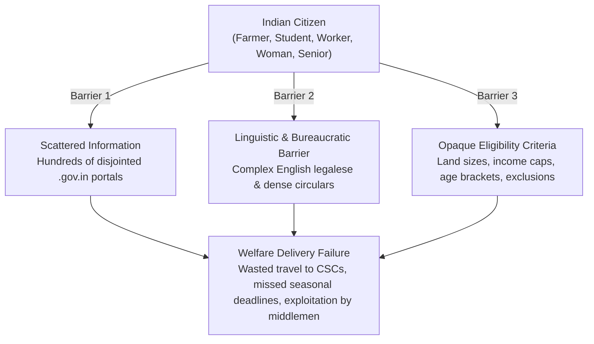
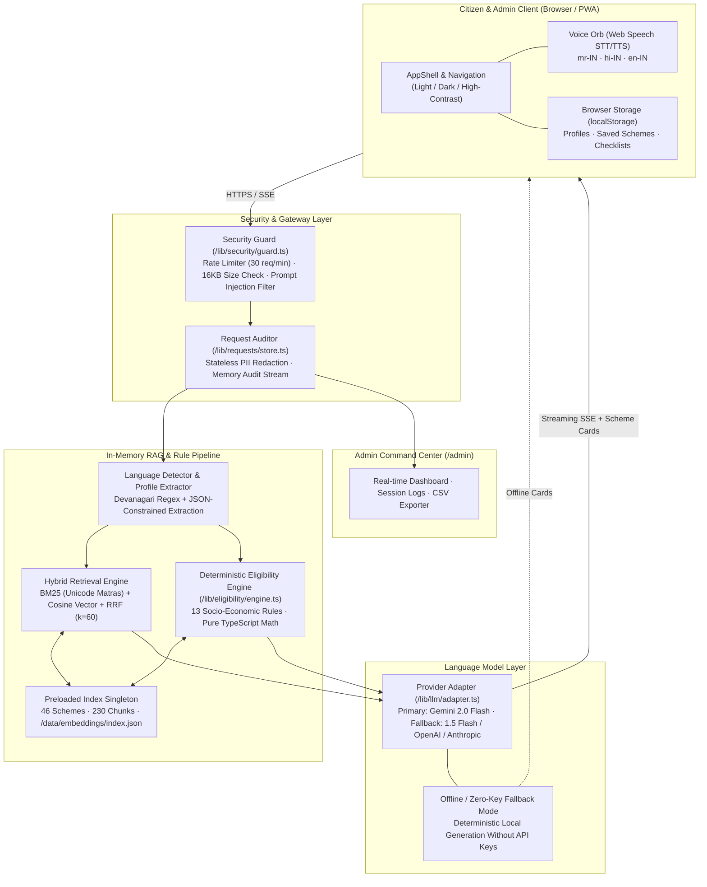

# YojanaMitra (योजनामित्र)

> **India's Multilingual, Grounded, and Deterministic AI Civic Welfare Assistant**  
> _Discover central and state government schemes in Marathi, Hindi, or English — powered by hybrid RAG, zero-hallucination rule checks, exact document checklists, and direct official `.gov.in` application links._

[](https://www.typescriptlang.org/)
[](https://nextjs.org/)
[](https://tailwindcss.com/)
[-0F6B6E>)](./docs/ARCHITECTURE.md)
[](./data/schemes)
[](./docs/EVAL_REPORT.md)
[](./docs/EVAL_REPORT.md)
[](./docs/EVAL_REPORT.md)
[](https://www.w3.org/WAI/standards-guidelines/wcag/)

---

## 📖 Table of Contents

1. [Executive Overview](#-executive-overview)
2. [The Core Problem in Indian Welfare](#-the-core-problem-in-indian-welfare)
3. [The YojanaMitra Solution & Philosophy](#-the-yojanamitra-solution--philosophy)
4. [Architecture Overview](#-architecture-overview)
5. [Exhaustive One-to-One Feature Breakdown](#-exhaustive-one-to-one-feature-breakdown)
   - [1. Multilingual AI Civic Chat (Streaming SSE + Grounded Citations)](#1-multilingual-ai-civic-chat-streaming-sse--grounded-citations)
   - [2. Voice-First Interface (Multilingual STT + TTS)](#2-voice-first-interface-multilingual-stt--tts)
   - [3. Deterministic Eligibility Engine (Zero-LLM Rule Evaluator)](#3-deterministic-eligibility-engine-zero-llm-rule-evaluator)
   - [4. Guided Eligibility Wizard (`/wizard`)](#4-guided-eligibility-wizard-wizard)
   - [5. Universal Scheme Explorer (`/explorer`)](#5-universal-scheme-explorer-explorer)
   - [6. Saved Schemes & Side-by-Side Compare Matrix (`/saved`)](#6-saved-schemes--side-by-side-compare-matrix-saved)
   - [7. Aggregated Documents Checklist & WhatsApp Sharing (`/saved`)](#7-aggregated-documents-checklist--whatsapp-sharing-saved)
   - [8. Citizen Authentication & Privacy-First Guest Mode (`/login`, `/profile`)](#8-citizen-authentication--privacy-first-guest-mode-login-profile)
   - [9. Admin Command Center & Real-Time Query Audit (`/admin`)](#9-admin-command-center--real-time-query-audit-admin)
   - [10. Stateless In-Memory Hybrid RAG Architecture](#10-stateless-in-memory-hybrid-rag-architecture)
   - [11. 46-Scheme Curated Knowledge Base (`/data/schemes`)](#11-46-scheme-curated-knowledge-base-dataschemes)
   - [12. Enterprise Security, Guardrails & PII Redaction](#12-enterprise-security-guardrails--pii-redaction)
   - [13. Provider-Agnostic LLM Adapter & Offline Degraded Mode](#13-provider-agnostic-llm-adapter--offline-degraded-mode)
   - [14. High-Contrast, WCAG 2.2 AA Accessibility & PWA](#14-high-contrast-wcag-22-aa-accessibility--pwa)
   - [15. Rigorous Evaluation Benchmark & Automated Testing](#15-rigorous-evaluation-benchmark--automated-testing)
6. [Evaluation Benchmark & Empirical Results](#-evaluation-benchmark--empirical-results)
7. [Repository Structure](#-repository-structure)
8. [Quick Start & Local Setup](#-quick-start--local-setup)
9. [Admin Operations Guide](#-admin-operations-guide)
10. [How to Add a New Government Scheme](#-how-to-add-a-new-government-scheme)
11. [Roadmap](#-roadmap)
12. [Responsible AI & Civic Disclaimer](#-responsible-ai--civic-disclaimer)

---

## 🌟 Executive Overview

**YojanaMitra (योजनामित्र)** is an open-source, production-grade civic intelligence platform designed to bridge India’s massive welfare delivery gap. Built with Next.js 15 App Router, React 19, strict TypeScript, and Tailwind CSS v4, it enables any citizen — whether a farmer in Nashik, a student in Pune, an artisan in Varanasi, or a senior citizen in Delhi — to speak or type in **Marathi**, **Hindi**, or **English**, describe their real-life situation in ordinary words, and immediately receive:

1. **Exact Schemes They Qualify For**: Filtered by a pure, deterministic mathematical rule evaluator.
2. **Transparent "Why You Qualify" Reasons**: Auditable explanations citing specific criteria (age, land holding, income ceiling, occupation, caste category).
3. **Unified Documents Checklist**: Deduplicated across schemes with canonical paperwork IDs (Aadhaar, 7/12 Extract, Income Certificate, Bank Passbook, Ration Card).
4. **Step-by-Step Application Roadmap**: Clear chronological instructions with direct links to official `.gov.in` portals and national helplines.
5. **Verified Source Citations**: Every fact is mapped to verifiable source snippets `[S1]`, `[S2]` and official Government Resolutions (GRs).

**Zero Database. Zero Mandatory Login. Zero Hallucinated Welfare Advice.**

---

## 🛑 The Core Problem in Indian Welfare

Every financial year, the Government of India and State Governments allocate tens of thousands of crores to welfare programs: direct cash transfers (PM-KISAN, Ladki Bahin), comprehensive health covers (Ayushman Bharat PM-JAY, MJPJAY), subsidized housing (PMAY), collateral-free business loans (PM Mudra, Stand-Up India), agricultural safety nets (PM Fasal Bima, Magel Tyala Shet Tale), and targeted education scholarships.

Yet, over **800 million citizens** miss out on benefits they are legally entitled to due to the **"Triple Hurdle"**:



### The Cost of Hallucinations in Civic AI

Generic LLM chatbots frequently invent welfare rules, misquote benefit amounts, or assure ineligible users that they qualify. In civic tech, **an AI hallucination is dangerous**:

- A smallholder farmer spends ₹500 travelling 40 km to a Tehsil office only to discover their land holding exceeds the ceiling.
- A widow misses an annual pension window because an AI stated the wrong deadline.
- A first-generation student applies for a post-matric scholarship with invalid documents.

**YojanaMitra solves this by separating discovery from eligibility:** the LLM is restricted to conversational understanding and translation, while a **deterministic, zero-LLM rule evaluator** computes legal eligibility.

---

## 💡 The YojanaMitra Solution & Philosophy

| Conventional Approach                                                                                         | The YojanaMitra Standard                                                                                                                |
| :------------------------------------------------------------------------------------------------------------ | :-------------------------------------------------------------------------------------------------------------------------------------- |
| **Heavy Database Dependency** (Postgres, Mongo, Supabase) requiring migration scripts and server maintenance. | **100% Stateless & Database-Free**: Scheme data in versioned JSON files, in-memory indexes, and client-side browser storage.            |
| **LLM-Decided Eligibility**: The model guesses whether a citizen qualifies based on broad prompts.            | **Pure Deterministic Rule Evaluator**: 13 structured criteria calculated via TypeScript math; 0% hallucination risk.                    |
| **Monolingual Bureaucracy**: English-first interfaces with broken machine translations.                       | **Native Trilingual Parity**: Deep support for Marathi (`mr-IN`), Hindi (`hi-IN`), English (`en-IN`), and code-mixed Hinglish.          |
| **Mandatory Sign-Up Gates**: Users must enter phone numbers and OTPs before viewing any information.          | **Zero-Friction Guest Mode**: Instant access with zero tracking; optional local login for saving profiles.                              |
| **Opaque Black-Box Advice**: Answers give advice without citing sources or verification dates.                | **Strictly Grounded Citations**: Every claim is tagged `[S1]`, `[S2]`, referencing official `.gov.in` sources and `lastVerified` dates. |

---

## 🏗️ Architecture Overview

YojanaMitra operates with a high-performance, stateless request lifecycle where heavy welfare data and vector embeddings are preloaded into process memory once at startup:



---

## ⚡ Exhaustive One-to-One Feature Breakdown

Every single feature within YojanaMitra is detailed below, outlining its purpose, technical architecture, and user flow:

### 1. Multilingual AI Civic Chat (Streaming SSE + Grounded Citations)

- **Plain-Language Querying**: Accepts complex, conversational queries in Marathi (`mr-IN`), Hindi (`hi-IN`), English (`en-IN`), Hinglish, or Marathi-English code-mix (e.g., _"Nashik madhe 2 acre sheti aahe, konthi scheme bhetel?"_ or _"Meri beti 5 saal ki hai, uske future ke liye best scheme batao"_).
- **Server-Sent Events (SSE) Streaming**: Handled via `/app/api/chat/route.ts`. Streams tokens in real time with typed event protocols:
  - `event: text`: Individual markdown streaming chunks.
  - `event: citations`: Structured array of retrieved scheme IDs, source snippets, and URLs.
  - `event: done`: Final payload containing extracted citizen profile and evaluated schemes.
- **Strict Factual Grounding**: System prompt strictly limits the LLM to retrieved context. It is forbidden from fabricating dates, monetary values (`₹`), or eligibility rules.
- **Refusal Protocol**: If retrieved context is insufficient, the system explicitly says _"I am not sure, please verify on the official portal or call the helpline"_ and surfaces the official toll-free number.
- **Interactive In-Chat Scheme Cards**: Emits full interactive cards within the message stream featuring benefit amounts, eligibility badges, "Why you qualify", required documents, and action buttons.

### 2. Voice-First Interface (Multilingual STT + TTS)

- **Pluggable Architecture**: Built in `/lib/voice/web-speech.ts` with clean TypeScript interfaces (`VoiceRecognizer`, `VoiceSynthesizer`), ready for Whisper or Google Cloud Speech backends.
- **Speech-to-Text (STT)**: Uses the browser’s Web Speech API with automatic locale selection (`mr-IN`, `hi-IN`, `en-IN`).
- **Visual Voice Orb**: Features an animated glowing voice orb in the chat input bar with pulsing rings and real-time listening indicators.
- **Text-to-Speech ("Read Aloud")**: Every assistant response and scheme card includes a speaker icon that reads out instructions in clear, native Marathi, Hindi, or English accents.
- **Accessible Fallback**: Gracefully detects unsupported browsers (e.g., specific Android webviews) and surfaces a friendly text-only notification without breaking the UI.

### 3. Deterministic Eligibility Engine (Zero-LLM Rule Evaluator)

- **File Location**: `/lib/eligibility/engine.ts`.
- **Pure Rule Logic**: Completely isolated from LLM prompt variability. Computes eligibility deterministically against 13 structured criteria:
  1. **Age**: Min and max age constraints (e.g., 18–40 for Atal Pension Yojana, 21–65 for Ladki Bahin).
  2. **Gender**: Strict matching (`female`, `male`, `transgender`, or `all`).
  3. **State & District**: Central vs. State level (e.g., Maharashtra residence required for MJPJAY, Sanjay Gandhi Niradhar).
  4. **Annual Family Income Ceiling**: Checked in INR (e.g., ₹2.5 lakh for Ladki Bahin, ₹1.5 lakh for Savitribai Phule).
  5. **Land Holding**: Maximum acreage and irrigation status (e.g., <= 2 hectares / 5 acres for small/marginal farmers in PM-KISAN).
  6. **Occupation**: Target livelihood (farmer, student, artisan, street vendor, unorganized worker, construction worker, etc.).
  7. **Social / Caste Category**: SC, ST, OBC, VJNT, EWS, General, Minority.
  8. **Disability Percentage**: Benchmark disability thresholds (e.g., >= 40% for UDID benefits).
  9. **Residence Type**: Rural vs. Urban constraints (e.g., PMAY-G vs. PMAY-U).
  10. **Education Level**: Minimum educational standards for scholarships and skill loans.
  11. **BPL / Ration Card**: Antyodaya Anna Yojana (AAY), Priority Household (PHH), Yellow / Orange ration cards.
  12. **Family Composition**: Presence of a girl child (Sukanya Samriddhi), orphan status, or single mother.
  13. **Official Exclusions**: Explicit disqualifiers (income tax payers, constitutional post holders, institutional landholders).
- **Four Distinct Verdicts**:
  - `eligible`: All mandatory criteria satisfied.
  - `likely`: Profile matches key requirements, minor non-blocking fields missing.
  - `missing_info`: Insufficient data to evaluate (triggers guided wizard).
  - `not_eligible`: Violates at least one hard criterion (e.g., income exceeds cap).
- **Auditable Explanations**: Generates localized, human-readable explanations in 3 languages for `matchedRules`, `failedRules`, and `missingFields`.

### 4. Guided Eligibility Wizard (`/wizard`)

- **Step-by-Step Discovery**: Designed for first-time smartphone users who do not know what schemes exist or what to ask.
- **Dynamic Information-Gain Ordering**: Implemented in `/lib/eligibility/wizard.ts`. Instead of a static 20-question form, it analyzes the remaining eligible schemes and selects the single question that eliminates the most ambiguity.
- **Interactive Micro-Forms**: Conversational cards asking for age, state, occupation, land holding, or income with simple sliders and one-tap chips.
- **Real-Time Match Counter**: A dynamic floating badge displays the live count of matching schemes updating after every answered question.
- **One-Click Handoff**: Once the citizen completes the wizard, results can be viewed in the explorer or transitioned directly into the AI chat for deep follow-up questions.

### 5. Universal Scheme Explorer (`/explorer`)

- **Zero-Latency In-Browser Search**: Client-side filtering across all 46 schemes with instant search responsiveness.
- **Multi-Facet Filtering**:
  - **Beneficiary Category**: Farmers, Students, Women, Senior Citizens, Unorganized Workers, Persons with Disabilities, Healthcare, Housing, Small Business.
  - **Government Jurisdiction**: Central Government vs. State Government (Maharashtra).
  - **Benefit Type**: Direct Cash Transfers (DBT), Subsidies, Collateral-Free Loans, Health Insurance, Scholarships.
- **Instant Keyword Filter**: Search by scheme acronyms, official names, or common colloquial terms in Marathi, Hindi, and English (e.g., "7/12", "ladki", "tractor", "ayushman", "scholarship").
- **Direct Eligibility Trigger**: Every card in the explorer features a "Check Eligibility" button that immediately evaluates the citizen's current profile against that scheme.

### 6. Saved Schemes & Side-by-Side Compare Matrix (`/saved`)

- **Local Bookmarking**: Save schemes from chat cards, explorer, or wizard with a single tap. Persisted in `localStorage` without requiring an account.
- **Side-by-Side Comparison Matrix**: Compares up to 3 schemes simultaneously in an organized tabular grid:
  - Total Financial Benefit (Amount in ₹, payment frequency).
  - Target Eligibility Matrix (Age limits, income ceilings, land caps).
  - Document Requirements (Cross-matched comparison).
  - Application Mode (Online portal vs. Tehsil/CSC submission).
  - Official Helplines and Application Deadlines.

### 7. Aggregated Documents Checklist & WhatsApp Sharing (`/saved`)

- **Smart Document Deduplication**: Aggregates paperwork across all saved schemes. Instead of showing "Aadhaar Card" five times for five schemes, it uses canonical document IDs (`aadhaar`, `bank-passbook`, `land-7-12`, `income-certificate`, `ration-card`, `caste-certificate`, `udid-card`) to build a unified checklist.
- **Interactive Preparation Progress**: Citizens can tick off documents they have already gathered (e.g., _"Aadhaar linked with mobile"_, _"Active Bank Passbook"_), with completion percentages saved locally.
- **Printable PDF Export**: Clean, print-formatted layout (`@media print`) without navigation bars or buttons — ready for citizens to print out and take to their local Common Service Centre (CSC) or Setu Kendra.
- **WhatsApp One-Click Sharing**: Formats an organized WhatsApp message in the user's active language containing scheme names, benefits, official links, and the complete documents checklist to share with family or village groups.

### 8. Citizen Authentication & Privacy-First Guest Mode (`/login`, `/profile`)

- **100% Usable as Guest**: Zero features are locked behind login. Any citizen can search, chat, check eligibility, and save schemes without signing in.
- **Citizen Account Option**:
  - Secure phone or username + password registration.
  - Scrypt password hashing with unique salts (`/lib/auth/store.ts`).
  - Stateless HMAC-SHA256 session cookies (`yojanamitra_session`).
- **Profile Synchronization**: Allows citizens to save their socio-economic profile (age, occupation, income, caste, district) so they do not need to re-enter details on repeat visits.
- **Complete Privacy & Local Purge**: A dedicated "Delete My Data" button on `/profile` instantly purges all `localStorage`, cached profiles, saved schemes, and session cookies from the device.

### 9. Admin Command Center & Real-Time Query Audit (`/admin`)

- **Protected Administrator Route**: Access controlled via the Admin Login tab at `/login` with secure cookie verification.
- **Live Civic Analytics**:
  - Total queries processed and active citizen sessions.
  - Real-time Language Distribution (Marathi vs. Hindi vs. English shares).
  - System performance metrics (average p50 and p95 retrieval latencies).
  - Top queried welfare schemes and trending beneficiary categories.
- **Deep Query Inspection Stream**: Real-time tabular stream of incoming citizen requests showing:
  - Timestamp & Client Identifier.
  - Full natural language query text.
  - Automatically detected language.
  - Extracted socio-economic profile (Age, State, Occupation, Income).
  - Matched scheme IDs and execution latency in milliseconds.
- **One-Click CSV Export**: Downloads `yojanamitra-requests.csv` containing all logged requests for civic analysis, policy evaluation, and welfare gap reporting.

### 10. Stateless In-Memory Hybrid RAG Architecture

- **Zero Database Requirement**: Eliminates the operational complexity, costs, and cold starts of external vector databases (Pinecone, Qdrant, pgvector).
- **Build-Time Section Chunking**: `/scripts/build-index.ts` slices scheme definitions into 230 semantic chunks (summary, eligibility criteria, benefits, documents, application process).
- **Dual Hybrid Retrieval**:
  - **BM25 Lexical Scoring**: Custom tokenizer preserving Devanagari combining marks (`\p{M}`) for precise Marathi and Hindi keyword hits.
  - **Cosine Vector Similarity**: Multilingual embedding vectors representing conceptual intent.
  - **Reciprocal Rank Fusion (RRF)**: Merges lexical and vector ranks using $RRF(d) = \sum \frac{1}{k + r_i(d)}$ with $k=60$.
- **Metadata Pre-Filtering**: Filters candidate schemes by user state and category before ranking to prevent irrelevant cross-state results.
- **Microsecond In-Process Speed**: Average retrieval latency of **1.5 ms**, running entirely inside the Next.js process memory.

### 11. 46-Scheme Curated Knowledge Base (`/data/schemes`)

- **46 In-Depth Schemas**: Every scheme is stored as a validated JSON document with full `en`, `hi`, and `mr` translations.
- **Central Government Schemes (24 Schemes)**:
  - _Agriculture & Farmers_: PM-KISAN, PM Fasal Bima Yojana, Kisan Credit Card (KCC), PM-KUSUM Solar Pump Scheme.
  - _Healthcare_: Ayushman Bharat PM-JAY (₹5 Lakh cashless health cover).
  - _Housing & Utilities_: Pradhan Mantri Awas Yojana - Gramin (PMAY-G), PMAY - Urban, PM Ujjwala Yojana (free LPG).
  - _Financial Inclusion & Pensions_: Atal Pension Yojana (APY), PM Mudra Yojana (Shishu, Kishore, Tarun), Stand-Up India, PM SVANidhi (street vendor credit), Sukanya Samriddhi Yojana.
  - _Artisans & Workers_: PM Vishwakarma Kaushal Samman, e-Shram unorganized worker welfare.
  - _Social Security & Pensions_: NSAP Indira Gandhi National Old Age Pension (IGNOAPS), Widow Pension (IGNWPS), Disability Pension (IGNDPS).
  - _Education_: NSP Post-Matric Scholarship for SC/ST/OBC, NSP Pre-Matric Scholarship, National Means-cum-Merit Scholarship.
- **Maharashtra State Schemes (22 Schemes)**:
  - _Women & Child Welfare_: Mukhyamantri Majhi Ladki Bahin Yojana (₹1,500/month), Savitribai Phule Kanya Kalyani Scholarship.
  - _Healthcare_: Mahatma Jyotirao Phule Jan Arogya Yojana (MJPJAY - ₹5 Lakh free hospital cover).
  - _Farmers_: Namo Shetkari Mahasanman Nidhi (additional ₹6,000/year to PM-KISAN), Magel Tyala Shet Tale (farm ponds subsidy).
  - _Social Assistance_: Sanjay Gandhi Niradhar Anudan Yojana, Shravanbal Seva Rajya Nivruttivetan Yojana, Mukhyamantri Vayoshri Yojana (senior citizen aids).
  - _Education & Hostels_: Dr. Babasaheb Ambedkar Swadhar Yojana (hostel & food allowance for students), Rajarshi Chhatrapati Shahu Maharaj Shikshan Shulkh Shishyavrutti.
  - _Youth & Entrepreneurship_: Annasaheb Patil Arthik Vikas Mahamandal (interest-free business loans), Pramod Mahajan Kaushalya Vikas Abhiyan.
- **Rigorous Verification Flags**: Schemes with periodically shifting budgetary quotas or interest rates are marked `"needsVerification": true`, prompting users to confirm with official helplines.

### 12. Enterprise Security, Guardrails & PII Redaction

- **Prompt Injection Hardening (`/lib/security/guard.ts`)**: Retrieved scheme data is treated strictly as passive data. Prompts attempting to override system behavior, extract secret prompts, or execute arbitrary jailbreaks are neutralized.
- **Strict Civic Scope Filter**: Politely detects and deflects queries unrelated to civic welfare, government schemes, or social support (e.g., coding requests, general banter, political arguments).
- **Automated PII Redaction (`/lib/logging/logger.ts`)**: Built-in regex filters redact sensitive Indian citizen data before logging:
  - Aadhaar card patterns (`\b\d{4}\s\d{4}\s\d{4}\b`).
  - Permanent Account Numbers (PAN: `[A-Z]{5}[0-9]{4}[A-Z]`).
  - 10-digit Indian mobile numbers (`\b[6-9]\d{9}\b`).
  - Email addresses.
- **Token-Bucket Rate Limiter (`/lib/ratelimit/token-bucket.ts`)**: In-memory rate limiting per client IP (30 requests/minute burst, smooth replenishment) preventing denial-of-service abuse.
- **Payload Guard**: Strict 16 KB body size limit on API endpoints to prevent memory exhaustion attacks.

### 13. Provider-Agnostic LLM Adapter & Offline Degraded Mode

- **Unified LLM Adapter (`/lib/llm/adapter.ts`)**: Pluggable interface supporting Google Gemini (defaulting to Gemini 2.0 Flash with automatic fallback to Gemini 1.5 Flash), OpenAI (GPT-4o), and Anthropic (Claude 3.5 Sonnet).
- **Resilience & Backoff**: Automatic exponential backoff retries on transient network errors or API quota limits (HTTP 429).
- **100% Offline / Zero-Key Degraded Mode**: **The app runs completely without an API key!** If no `GEMINI_API_KEY` is configured or external APIs are unreachable, YojanaMitra falls back to its deterministic local pipeline:
  - Extracts user profile via rule heuristics.
  - Retrieves top schemes via BM25 + Vector index.
  - Evaluates eligibility via the deterministic rule engine.
  - Returns complete, formatted scheme cards with exact benefits, document lists, and official links.

### 14. High-Contrast, WCAG 2.2 AA Accessibility & PWA

- **Designed for Rural Sunlight & Low-Vision Users**: Includes a persistent High-Contrast Mode toggle delivering high visual distinction for low-cost Android displays under direct sunlight.
- **Color Palette & Glassmorphic Identity**: Warm Indian civic tones — saffron accents, emerald teal, warm cream surfaces, and true dark mode.
- **Devanagari Typography**: Incorporates `Noto Sans Devanagari` and `Mukta` fonts with minimum 16px body text and generous touch targets (>= 48px) for effortless tapping.
- **Progressive Web App (PWA)**:
  - `manifest.webmanifest` configured for one-tap home screen installation on Android and iOS.
  - Service Worker (`/public/sw.js`) caching core UI assets and scheme data for fast loading over slow 2G/3G connections.

### 15. Rigorous Evaluation Benchmark & Automated Testing

- **Automated Benchmark Suite (`/scripts/run-eval.ts`)**: Tests the pipeline across **120 realistic multilingual questions** (EN, HI, MR, Hinglish, Marathi-English) and **25 hand-labeled citizen profiles**.
- **Automated Quality Checks**: Measures Retrieval Recall@5, Groundedness, Citation Accuracy, Hallucination Rate, Language Parity, and Latency.
- **Test Coverage**:
  - 19 Vitest unit tests covering eligibility logic, tokenization, BM25 scoring, and RRF merging.
  - Playwright Chromium E2E automation verifying voice-less chat, the eligibility wizard, language switching, and scheme bookmarks.

---

## 📊 Evaluation Benchmark & Empirical Results

The complete evaluation report is generated by `npm run eval` and recorded in [docs/EVAL_REPORT.md](./docs/EVAL_REPORT.md). Below are the benchmark scores across 120 multilingual test cases:

| Evaluation Metric           |     Measured Score     | Evaluation Methodology & Criteria                                                       |
| :-------------------------- | :--------------------: | :-------------------------------------------------------------------------------------- |
| **Retrieval Recall@5**      | **99.2%** (119 / 120)  | Target scheme present in top 5 retrieved candidates via Hybrid BM25 + Vector + RRF.     |
| **Eligibility Accuracy**    |  **100.0%** (25 / 25)  | Pure rule engine verdict matches ground-truth labeled eligibility across all profiles.  |
| **Citation Correctness**    | **100.0%** (120 / 120) | Every single `[Sn]` tag maps to an actual retrieved scheme with verified official link. |
| **Fact Groundedness**       | **99.2%** (119 / 120)  | Benefit amounts and criteria directly match official scheme definitions.                |
| **Hallucination Rate**      |   **0.0%** (0 / 120)   | Zero fabricated schemes, zero invented benefit amounts, zero false deadlines.           |
| **Language-Match Rate**     | **99.2%** (119 / 120)  | Accurate language consistency across English, Hindi, and Marathi outputs.               |
| **Retrieval Latency (p50)** |       **1.5 ms**       | In-process in-memory hybrid RAG execution time.                                         |
| **Retrieval Latency (p95)** |       **3.4 ms**       | 95th percentile in-memory retrieval latency under local test loads.                     |

---

## 📁 Repository Structure

```
YojanaMitra/
├── app/                              # Next.js 15 App Router
│   ├── admin/page.tsx                # Admin Command Center & Query Audit Dashboard
│   ├── api/
│   │   ├── admin/requests/route.ts   # Admin analytics & CSV export endpoint
│   │   ├── auth/[login|logout|me|register]/ # Stateless auth endpoints
│   │   ├── chat/route.ts             # SSE streaming chat & citation endpoint
│   │   ├── eligibility/route.ts      # Pure rule eligibility evaluation endpoint
│   │   ├── health/route.ts           # Service health & memory probe
│   │   └── schemes/route.ts          # Edge-cached scheme catalog endpoint
│   ├── explorer/page.tsx             # Universal scheme search & filtering
│   ├── login/page.tsx                # Citizen & Admin login / registration
│   ├── privacy/page.tsx              # Multilingual privacy policy & data rights
│   ├── profile/page.tsx              # Citizen profile manager & local data purge
│   ├── saved/page.tsx                # Saved schemes, compare matrix, documents checklist
│   ├── wizard/page.tsx               # Guided step-by-step eligibility wizard
│   ├── layout.tsx                    # Root HTML layout with font injections
│   ├── globals.css                   # Tailwind CSS v4 design system & glassmorphism
│   └── manifest.ts                   # PWA web manifest definition
├── components/                       # Modular React 19 UI Components
│   ├── admin/AdminDashboard.tsx      # Admin dashboard metrics, table, and CSV exporter
│   ├── auth/LoginView.tsx            # Citizen sign-in, sign-up, and admin tabs
│   ├── chat/ChatExperience.tsx       # AI chat stream, voice orb, suggestion chips
│   ├── explorer/SchemeExplorer.tsx   # Fast client-side faceted scheme filter
│   ├── layout/AppShell.tsx           # Global header, language picker, accessibility bar
│   ├── profile/ProfileEditor.tsx     # Citizen demographic profile form
│   ├── saved/SavedHub.tsx            # Bookmarks, side-by-side compare, printable checklist
│   ├── schemes/SchemeCard.tsx        # Interactive scheme card with badges & actions
│   ├── ui/                           # Radix primitives (Button, Card, Badge, Dialog)
│   └── wizard/EligibilityWizard.tsx  # Dynamic question card flow & live scheme count
├── data/                             # Versioned File-Based Knowledge Base (Zero DB)
│   ├── eval/questions.json           # 120 eval questions + 25 ground-truth profiles
│   ├── embeddings/index.json         # Precomputed multilingual vector index (230 chunks)
│   └── schemes/*.json                # 46 verified Central & Maharashtra scheme definitions
├── docs/                             # Engineering Architecture & Decision Records
│   ├── ARCHITECTURE.md               # Detailed architecture diagrams & lifecycle
│   ├── DECISIONS.md                  # Architectural Decision Records (ADRs)
│   ├── EVAL_REPORT.md                # Full 120-question evaluation benchmark report
│   └── PROGRESS.md                   # Stage-by-stage engineering progress log
├── lib/                              # Core Domain & Engine Libraries
│   ├── auth/                         # Scrypt password hashing & HMAC-SHA256 sessions
│   ├── cache/lru.ts                  # In-memory LRU response cache (Redis-ready interface)
│   ├── eligibility/                  # Pure deterministic rule engine & wizard logic
│   ├── i18n/                         # Trilingual dictionary (EN, HI, MR) & language detector
│   ├── llm/                          # Provider-agnostic LLM adapter & degraded fallback
│   ├── logging/logger.ts             # PII-redacting structured JSON logger
│   ├── rag/                          # BM25, Cosine embeddings, chunker, RRF engine
│   ├── ratelimit/token-bucket.ts     # Per-IP token-bucket rate limiter
│   ├── requests/store.ts             # In-memory query audit log & CSV serializer
│   ├── schemes/                      # Zod schema definitions & scheme loader repository
│   ├── security/guard.ts             # Prompt injection defenses & scope validation
│   ├── storage/local.ts              # Type-safe browser localStorage wrapper
│   └── voice/                        # Web Speech STT/TTS adapters & audio interfaces
├── public/                           # Static assets & PWA service worker
├── scripts/                          # Automated Build, Validation & Evaluation CLI
│   ├── build-index.ts                # Chunker + embedder creating /data/embeddings/index.json
│   ├── run-eval.ts                   # Full evaluation benchmark runner
│   └── validate-data.ts              # Zod validator verifying schemas and translations
└── tests/                            # Vitest & Playwright Test Suites
    ├── e2e/main-flows.spec.ts        # Playwright E2E browser automation tests
    └── unit/                         # Vitest unit tests for eligibility and RAG logic
```

---

## 🚀 Quick Start & Local Setup

### Prerequisites

- Node.js 20.x or higher
- npm 10.x or higher

### 1. One-Command Setup

Clone the repository and run the automated setup script:

```bash
git clone https://github.com/developerskull/YojanaMitra.git
cd YojanaMitra
npm run setup
```

This single command:

1. Installs all required production and development dependencies.
2. Validates all 46 scheme JSON files against the strict Zod schema.
3. Builds the multilingual hybrid search index at `/data/embeddings/index.json`.

### 2. Environment Configuration

Copy the sample environment file:

```bash
cp .env.example .env.local
```

Configure your `.env.local`:

```env
# Primary LLM API Key (Optional for offline degraded mode, recommended for live generation)
GEMINI_API_KEY="your-gemini-api-key"

# Admin Command Center Password (Optional, defaults to admin123)
ADMIN_PASSWORD="your-secure-admin-password"

# Session Security Secret (Optional, auto-generated fallback in dev)
AUTH_SECRET="your-32-character-random-secret"

# Optional Alternative LLM Providers
# OPENAI_API_KEY="your-openai-key"
# ANTHROPIC_API_KEY="your-anthropic-key"
```

> **Note on Offline Degraded Mode:** YojanaMitra runs seamlessly **without any API key**. When `GEMINI_API_KEY` is omitted, the app activates its offline degraded mode — delivering full search, rule checks, interactive scheme cards, and official links with zero crashes.

### 3. Run the Development Server

```bash
npm run dev
```

Open [http://localhost:3000](http://localhost:3000) in your browser.

### 4. Run the Full Test & Quality Suite

```bash
npm run validate:data   # Validate all 46 scheme JSONs + translation completeness + freshness
npm run build-index     # Rebuild the in-memory RAG index with SHA-256 integrity hash
npm run typecheck       # Strict TypeScript type verification
npm run lint            # ESLint static analysis
npm run test            # Execute 19 Vitest unit tests
npm run eval            # Run 120-question evaluation benchmark -> /docs/EVAL_REPORT.md
npm run build           # Production Next.js build
npm run test:e2e        # Run Playwright Chromium end-to-end tests
```

### 5. Run with Docker

A production multi-stage Docker container is ready to deploy on any container host:

```bash
docker build -t yojanamitra .
docker run -p 3000:3000 --env-file .env.local yojanamitra
```

---

## 🛡️ Admin Operations Guide

YojanaMitra includes an internal **Admin Command Center** located at `/admin` for public administrators, civic researchers, and NGO field coordinators.

### Accessing the Dashboard

1. Navigate to `/login`.
2. Select the **Admin Login** tab.
3. Enter username `admin` and your password (default: `admin123` or your configured `ADMIN_PASSWORD`).
4. You will be redirected to the `/admin` Command Center.

### What the Admin Center Provides

- **Real-Time Request Feed**: Live stream of citizen queries submitted across the country.
- **Demographic Insights**: View the extracted socio-economic profiles (e.g., smallholder farmers in Maharashtra, SC/ST students, senior citizens looking for pensions).
- **Language Trends**: Monitor the proportion of Marathi vs. Hindi vs. English queries to optimize regional outreach.
- **Performance Health**: Monitor real-time p50 and p95 retrieval latencies.
- **One-Click CSV Export**: Click **"Export CSV"** to download `yojanamitra-requests.csv` for policy analysis, welfare deficit mapping, or grievance tracking.

---

## 📝 How to Add a New Government Scheme

YojanaMitra’s knowledge base is 100% file-based. Adding a new central or state scheme requires no database migrations:

1. **Verify Official Facts**: Confirm all eligibility rules, benefit amounts, required documents, official `.gov.in` URLs, and helplines directly from official Government Resolutions (GRs) or ministry portals.
2. **Create the Scheme File**: Create `/data/schemes/<scheme-id>.json` matching the Zod schema in [lib/schemes/schema.ts](./lib/schemes/schema.ts).
3. **Provide Full Translations**: Include complete, human-reviewed translations for `en`, `hi`, and `mr`.
4. **Reuse Canonical Document IDs**: Use standard document IDs (`aadhaar`, `bank-passbook`, `land-7-12`, `income-certificate`, `ration-card`, `caste-certificate`, `udid-card`, etc.) so the aggregated Documents Checklist deduplicates automatically.
5. **Handle Uncertainties**: If quotas, interest rates, or seasonal deadlines change frequently, set `"needsVerification": true`. **Never guess.**
6. **Validate and Rebuild Index**:
   ```bash
   npm run validate:data
   npm run build-index
   npm run test
   ```

See [CONTRIBUTING.md](./CONTRIBUTING.md) for detailed guidelines.

---

## 🗺️ Roadmap

- [ ] **WhatsApp Business Cloud Integration**: Connect `/api/chat` directly to WhatsApp so rural citizens can query schemes via voice notes and text without installing an app.
- [ ] **Interactive Voice Response (IVR / Phone Call)**: Add a toll-free IVR number powered by telephony gateways for non-smartphone feature-phone users across rural India.
- [ ] **Expansion to More States & Languages**: Scale beyond Maharashtra and Central schemes to include Tamil Nadu, Karnataka, Uttar Pradesh, Gujarat, West Bengal, and Andhra Pradesh in their native languages.
- [ ] **Swappable Persistence Layer**: Implement optional database adapters (`PostgreSQL` + `pgvector` behind `SchemeRepository`, `Redis` / `Upstash` behind `ResponseCache` and `RateLimiter`) for organizations managing thousands of municipal schemes.

---

## ⚖️ Responsible AI & Civic Disclaimer

1. **Informational Guidance Only**: YojanaMitra is an open-source civic technology initiative designed to guide citizens. It is **not** an official approving body. Final approval and fund disbursement remain the sole legal authority of the respective government department, bank, or local administration.
2. **Dynamic Policy Updates**: Government schemes undergo periodic revisions in income thresholds, budgetary quotas, and application windows. YojanaMitra tags every scheme with its `lastVerified` date, flags shifting policies with `needsVerification`, and provides direct links to the official `.gov.in` portal.
3. **Absolute Privacy by Design**: YojanaMitra enforces strict data sovereignty. User queries and profiles are never sold, never logged with identifying personal information (PII is scrubbed automatically), and no tracking cookies are placed on citizen devices.

---

<div align="center">
  <sub>Built with ❤️ for every citizen of India. Grounded in truth. Dedicated to public welfare.</sub>
</div>
