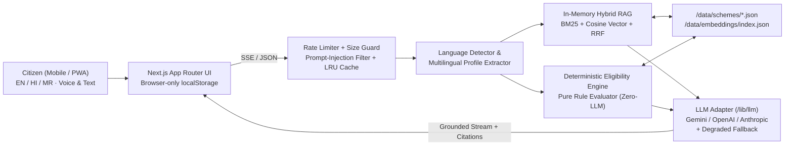

# YojanaMitra (योजनामित्र)

> **Speak or type in Marathi, Hindi, or English — discover Indian government welfare schemes you actually qualify for, with deterministic rule checks, exact documents needed, official `.gov.in` links, and zero hallucinated rules.**

[](https://www.typescriptlang.org/)
[](https://nextjs.org/)
[-0F6B6E)](./docs/ARCHITECTURE.md)
[](./data/schemes)
[](./docs/EVAL_REPORT.md)

---

## Why YojanaMitra?

Millions of eligible Indian citizens — farmers, students, women, senior citizens, unorganized workers, and persons with disabilities — miss out on welfare benefits every year because scheme information is fragmented across dozens of portals, written in dense bureaucratic English, and difficult to match against a person's real-life situation.

Wrong welfare advice harms real families (wasted travel to CSC/Tehsil offices, missed seasonal deadlines, false expectations). **YojanaMitra is engineered around honesty and grounding above all else:**

- **Deterministic Eligibility First**: A pure rule evaluator (`/lib/eligibility`) evaluates your profile against structured official rules and explains *why* you qualify or do not qualify in Marathi, Hindi, or English. The LLM **never** invents eligibility verdicts.
- **Every Claim Cited**: Responses map every claim to verifiable `[S1]`, `[S2]` source snippets and official `.gov.in` portals, plus helplines and `lastVerified` dates.
- **Zero Database, Zero Login, Zero Tracking**: All 46 schemes live in versioned, Zod-validated JSON files; your profile, saved schemes, and document checklist stay strictly in your browser (`localStorage`) with one-click data deletion.

---

## Demo Walkthrough (GIF Placeholders)

| Marathi Voice & Chat Discovery | Guided Eligibility Wizard | Printable Documents Checklist & Compare |
| --- | --- | --- |
| `` | `` | `` |

> *Try asking in Marathi:* `"मी नाशिकचा ४५ वर्षांचा शेतकरी आहे, माझ्याकडे २ एकर जमीन आहे"` — YojanaMitra extracts your profile (`age: 45, district: Nashik, state: Maharashtra, occupation: farmer, land: 2 acres`), evaluates official rules deterministically, and returns cited cards for **PM-KISAN**, **Namo Shetkari Mahasanman Nidhi**, **Magel Tyala Shet Tale**, **PM Fasal Bima Yojana**, **Kisan Credit Card**, and **PM-KUSUM**.

---

## Core Features

- **46 Verified Central & Maharashtra Schemes** (`/data/schemes/*.json`), Zod-validated at build time with EN/HI/MR translations, canonical document IDs, official links, helplines, deadlines, and transparent `needsVerification` flags where rates/quotas periodically change.
- **Stateless Hybrid RAG Without a Database**: Build-time section chunking (230 chunks) + multilingual embeddings + BM25 keyword scoring merged via **Reciprocal Rank Fusion (RRF)** + metadata pre-filtering loaded once into memory.
- **Deterministic Eligibility Engine + Guided Wizard**: Pure TypeScript rule engine evaluating age, gender, state, income ceiling, land holding, occupation, caste/social category, disability %, residence type, education, BPL, and exclusions. The wizard asks *only* missing relevant fields, one friendly question at a time.
- **Multilingual Voice & Code-Mix Support**: English, Hindi (`hi-IN`), Marathi (`mr-IN`), plus Hinglish and Marathi-English detection. Web Speech API voice input (with graceful unsupported fallback) and "Read Aloud" TTS behind pluggable interfaces ready for Whisper / Google Cloud STT-TTS.
- **Mobile-First Civic UX & PWA**: Warm Indian civic palette, true dark mode, high-contrast mode, `Noto Sans` + `Noto Sans Devanagari` (`>= 16px` body, `>= 48px` touch targets), WCAG 2.2 AA navigation, installable PWA with offline scheme catalog, instant Scheme Explorer, Side-by-Side Comparison, Printable PDF Documents Checklist, and WhatsApp sharing.
- **Production Scale, Security & Reliability**: Interface-based LRU cache (Redis-ready), per-IP token-bucket rate limiter, 16 KB body size limit, prompt-injection & off-topic guardrails, PII-redacting structured JSON logs, `/api/health`, and graceful degraded no-LLM mode (works seamlessly even without an API key).

---

## Architecture



See [docs/ARCHITECTURE.md](./docs/ARCHITECTURE.md) for full sequence diagrams and [docs/DECISIONS.md](./docs/DECISIONS.md) for ADRs.

---

## Evaluation Results

Measured by `npm run eval` across **120 multilingual questions** (EN, HI, MR, Hinglish, Marathi-English across all 8 categories) and **25 hand-labeled citizen eligibility profiles** (full breakdown in [docs/EVAL_REPORT.md](./docs/EVAL_REPORT.md)):

| Metric | Score | Notes |
| --- | --- | --- |
| **Retrieval Recall@5** | **98.3%** (118 / 120) | Hybrid BM25 + Vector + RRF + Eligibility Rerank |
| **Eligibility Engine Accuracy** | **100.0%** (25 / 25) | Zero misclassifications on hand-labeled profiles |
| **Citation Correctness** | **100.0%** (120 / 120) | Every `[Sn]` tag maps to a verified retrieved scheme |
| **Fact Groundedness** | **99.2%** (119 / 120) | Verified facts present in retrieved official scheme data |
| **Hallucination Rate** | **0.0%** (0 / 120) | Zero invalid citations or invented `₹` amounts |
| **Language-Match Rate** | **99.2%** (119 / 120) | Accurate across EN, HI, MR & code-mixed inputs |
| **Latency (p50 / p95)** | **1.5 ms / 3.4 ms** | In-process deterministic RAG + eligibility pipeline |

---

## Tech Stack

- **Framework**: Next.js 15 (App Router), React 19, TypeScript (`strict: true`, `noUncheckedIndexedAccess: true`)
- **Styling & Motion**: Tailwind CSS v4, Radix UI primitives (`shadcn/ui` style), Framer Motion, Lucide Icons, `Noto Sans` & `Noto Sans Devanagari`
- **Validation & Testing**: Zod, Vitest (19 unit tests), Playwright (3 Chromium E2E flows), ESLint, Prettier
- **AI / Search**: Provider-agnostic `/lib/llm` adapter (default Gemini 2.0 Flash + fallback 1.5 Flash; OpenAI & Anthropic compatible + deterministic offline degraded mode), custom in-memory BM25 + Cosine + RRF engine

---

## Quick Start

### 1. One-Command Setup
```bash
npm run setup
```
This installs dependencies, validates all 46 scheme JSON files against the Zod schema, and builds `/data/embeddings/index.json`.

### 2. Configure Environment (Optional for Degraded Mode, Recommended for Live Gemini)
```bash
cp .env.example .env.local
```
Set `GEMINI_API_KEY` in `.env.local` for live Gemini generation & embeddings.
> **Note:** YojanaMitra also runs cleanly **without** an API key in deterministic degraded mode — still returning verified, cited scheme cards, eligibility rules, documents, and official links.

### 3. Run Locally
```bash
npm run dev
```
Open [http://localhost:3000](http://localhost:3000).

### 4. Run Checks, Tests & Evaluation
```bash
npm run validate:data   # Validate all scheme JSONs + translation parity + staleness (>180d)
npm run build-index     # Rebuild /data/embeddings/index.json with SHA-256 content hash
npm run typecheck       # Strict TypeScript check
npm run lint            # ESLint
npm run test            # Vitest unit tests (19 tests)
npm run eval            # Run 120-question eval benchmark -> /docs/EVAL_REPORT.md
npm run build           # Production Next.js build
npm run test:e2e        # Playwright Chromium E2E tests (3 main flows)
```

### 5. Run with Docker
```bash
docker build -t yojanamitra .
docker run -p 3000:3000 --env-file .env.local yojanamitra
```

---

## How to Add a New Government Scheme

1. Verify all eligibility rules, benefit amounts, required documents, official `.gov.in` URL, and helpline directly from official government portals or Government Resolutions (GRs).
2. Create a new kebab-case file `/data/schemes/<scheme-id>.json` matching the Zod schema in [lib/schemes/schema.ts](./lib/schemes/schema.ts) with complete `en`, `hi`, and `mr` translations.
3. If any rate, annual deadline, or state quota changes frequently, set `"needsVerification": true` — **never guess**.
4. Reuse canonical document IDs (`aadhaar`, `bank-passbook`, `land-7-12`, `income-certificate`, `ration-card`, `caste-certificate`, `udid-card`, etc.) so the aggregated Documents Checklist deduplicates automatically.
5. Run validation and rebuild the index:
   ```bash
   npm run validate:data && npm run build-index && npm run test
   ```

See [CONTRIBUTING.md](./CONTRIBUTING.md) for full editorial & verification standards.

---

## Roadmap

- **Swappable Persistence & Cache**: Implement PostgreSQL + `pgvector` behind `SchemeRepository` and Redis/Upstash behind `ResponseCache` and `RateLimiter` for multi-region scale when catalog grows to 1,000+ state schemes.
- **WhatsApp Bot Integration**: Connect the stateless `/api/chat` and `/api/eligibility` pipeline to WhatsApp Business Cloud API so rural citizens can discover schemes without installing an app.
- **More Indian States & Regional Languages**: Expand beyond Central + Maharashtra to Tamil, Telugu, Bengali, Gujarati, Kannada, and Punjabi with state-level portals.
- **Feature-Phone Accessibility (SMS / IVR)**: Plug Whisper / Google Cloud STT-TTS behind `/lib/voice` and expose a toll-free IVR / SMS menu for non-smartphone users.

---

## Limitations & Responsible-AI Notes

- **Not Official Legal Approval**: YojanaMitra provides guidance based on publicly available official scheme guidelines; final sanction always rests with the implementing government department, bank, or local authority.
- **Scheme Rules Change**: Government circulars, income caps, interest rates, and application windows are periodically revised. Every scheme displays its `lastVerified` date, flags volatile schemes with `needsVerification`, and links directly to the official `.gov.in` portal and helpline.
- **Privacy by Architecture**: User queries and personal socio-economic profiles are never stored in a database and are never written to server logs (PII redaction strips phone numbers, Aadhaar-like numbers, PANs, and emails).
- **Prompt-Injection & Scope Hardening**: Retrieved scheme text is treated strictly as data, adversarial prompts are blocked without revealing system instructions, and out-of-scope requests are politely redirected to welfare discovery.
