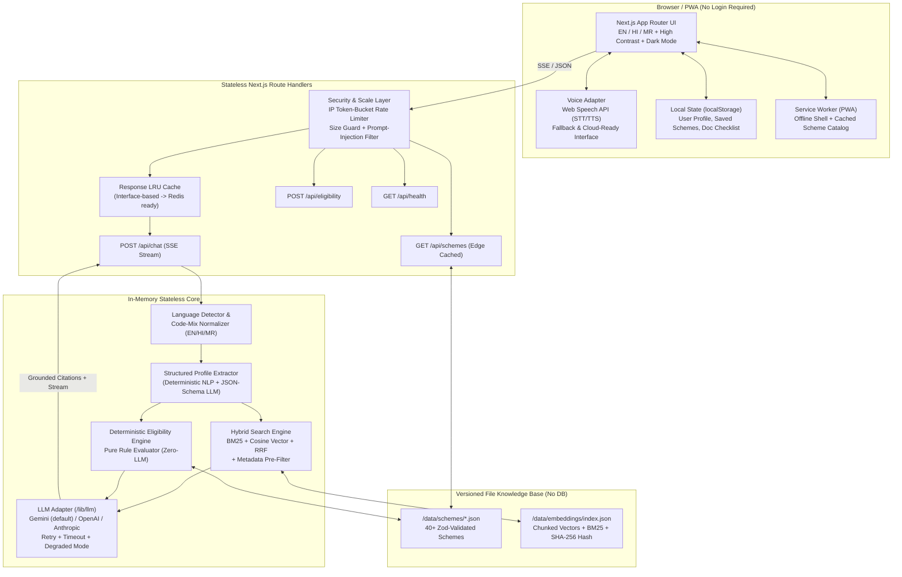
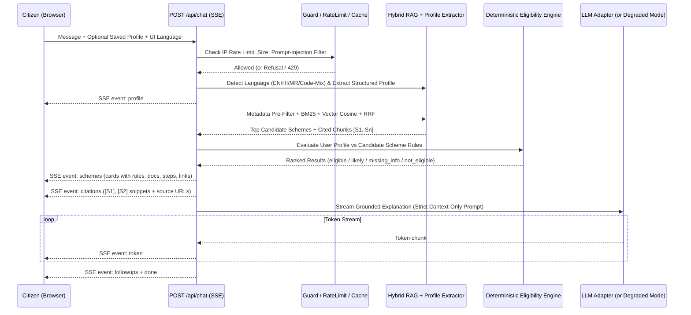

# YojanaMitra Architecture

## Core Design Goals
1. **Zero Database, Horizontally Scalable**: All welfare scheme knowledge lives in versioned JSON files under `/data/schemes` and pre-computed hybrid search indexes under `/data/embeddings/index.json`. Every API instance loads the immutable dataset into module-level memory once and serves requests statelessly.
2. **Trust Through Determinism**: Eligibility is **never** decided solely by an LLM. A pure rule evaluator (`/lib/eligibility`) evaluates structured user attributes against Zod-validated scheme rules, returning exact matched rules, failed rules, and missing fields in English, Hindi, and Marathi. The LLM only explains verified context with `[S1]`, `[S2]` source citations.
3. **Graceful Degradation**: If an LLM provider is slow, unreachable, rate-limited, or unconfigured, YojanaMitra seamlessly falls back to a secondary model and finally to a deterministic no-LLM mode that still delivers verified scheme cards, eligibility reasons, documents, and official links.
4. **Swappable Interfaces**: Scheme repository, embedding index, response cache (LRU), rate limiter (token bucket), LLM provider, and voice STT/TTS adapters are all defined behind TypeScript interfaces so PostgreSQL/pgvector, Redis, or cloud STT/TTS can be dropped in later without rewriting application code.

---

## System Architecture

---

## Query Execution Pipeline (`/api/chat`)

---

## Directory Layout

| Path | Responsibility |
| --- | --- |
| `/app` | Next.js App Router pages, layouts, PWA manifest, and API route handlers |
| `/components` | Accessible UI primitives (`shadcn/ui`-style), chat interface, scheme cards, wizard, explorer |
| `/lib/schemes` | Zod schemas, TypeScript types, and singleton scheme repository interface |
| `/lib/llm` | Provider-agnostic LLM & embedding adapter (Gemini, OpenAI, Anthropic, degraded mode) |
| `/lib/rag` | Chunking, BM25, cosine vector search, RRF, profile extraction, prompt builder |
| `/lib/eligibility` | Pure deterministic rule engine + localized rule explanation generator |
| `/lib/i18n` | EN/HI/MR translations, language detector, code-mix normalizer |
| `/lib/voice` | Web Speech API STT/TTS implementation behind a pluggable cloud-ready adapter |
| `/lib/ratelimit` | Interface-based per-IP token bucket rate limiter |
| `/lib/cache` | Interface-based in-memory LRU cache |
| `/lib/security` | Prompt injection filter, input sanitizer, off-topic/harm guard |
| `/lib/logging` | PII-redacting structured JSON logger |
| `/data/schemes` | One versioned JSON file per Indian government scheme |
| `/data/embeddings` | Build-time generated hybrid index (`index.json`) with content hash |
| `/data/eval` | 100+ multilingual evaluation questions and labeled profiles |
| `/scripts` | `validate-data.ts`, `build-index.ts`, `run-eval.ts` |
| `/tests` | Vitest unit tests (`/tests/unit`) and Playwright E2E tests (`/tests/e2e`) |
| `/docs` | Architecture, architectural decisions, progress log, and evaluation report |
