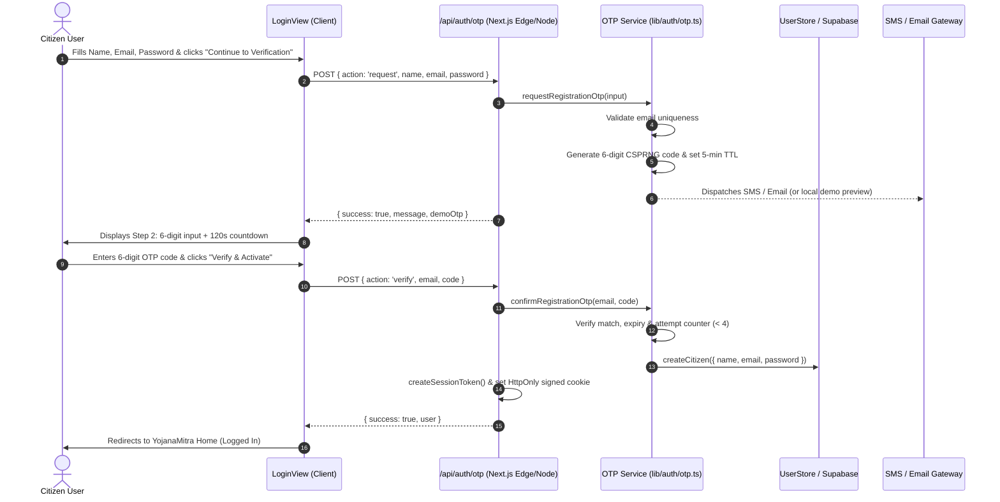

# YojanaMitra Citizen Registration & OTP Verification Guide

This document provides a comprehensive architectural and operational guide to the **Two-Step OTP (One-Time Password) Verification Workflow** implemented for Citizen account creation in YojanaMitra.

---

## 1. Overview & Civic Rationale

Under Indian e-Governance standards (e.g., DigiLocker, PM-Kisan eKYC, Aaple Sarkar, Umang), citizen onboarding must verify the citizen's contact coordinates before granting access to personal benefit trackers and sensitive document vaults.

YojanaMitra implements a frictionless, secure, 2-step registration process:
1. **Step 1 (Citizen Details)**: Citizen provides Name, Email, and Password.
2. **Step 2 (OTP Verification)**: Citizen enters a cryptographically random 6-digit code received via SMS/Email to finalize account creation and establish a signed, tamper-proof session.



---

## 2. Technical Architecture

### 2.1 Core Components

| Component | Path | Responsibility |
|---|---|---|
| **OTP Service** | `lib/auth/otp.ts` | Generates 6-digit CSPRNG codes (`crypto.randomInt`), tracks pending registrations in memory/Redis with 5-minute TTL, enforces max 4 invalid attempts before lockout. |
| **API Route** | `app/api/auth/otp/route.ts` | Discriminated union Zod validation for `action: 'request' \| 'verify' \| 'resend'`. Sets the secure signed session cookie upon successful verification. |
| **Client UI** | `components/auth/LoginView.tsx` | Two-step interactive UI with 120s timer countdown, numeric 6-digit formatted input, demo auto-fill chip for local testing, and full EN / HI / MR multilingual copy. |
| **User Store** | `lib/auth/store.ts` | Persists verified citizen records with timing-safe scrypt password hashes and role `'user'`. |

---

## 3. Security & Anti-Abuse Measures

1. **Cryptographically Secure Random Numbers**:
   Generated using Node.js `node:crypto`'s `crypto.randomInt(900000)`, ensuring uniform distribution between `100000` and `999999` with zero predictability.
2. **5-Minute Time-To-Live (TTL)**:
   Codes expire automatically 300 seconds after generation.
3. **Attempt Limiter (Lockout Protection)**:
   Citizens are granted a maximum of **4 attempts**. After 4 incorrect entries, the pending registration is purged immediately to prevent brute-force attacks.
4. **Resend Cooldown (Anti-Flooding)**:
   Citizens must wait at least 30 seconds before requesting a new OTP, preventing SMS spamming and gateway abuse.
5. **Signed Session Cookies**:
   Upon verification, a HMAC-SHA256 signed JWT session cookie (`HttpOnly`, `SameSite=Lax`, `Secure` in production) is issued immediately, logging the user in seamlessly without requiring a separate sign-in step.

---

## 4. Local Development & Testing

During local development and testing, you don't need real SMS credits or an active gateway:
1. Open `http://localhost:3000/login` in your browser.
2. Click **Create Account** under the Citizen tab.
3. Enter your Name, Email, and Password, then click **Continue to Verification**.
4. The screen transitions to **Step 2 of 2 · OTP Verification**:
   - The generated code is displayed in the **Quick Demo Chip** (`Demo OTP: 123456`).
   - Click **Paste Code** to auto-populate the 6 digits.
   - The code is also logged to your server terminal:
     ```
     [OTP SERVICE] Generated 6-digit verification code for user@domain.com: 533369 (Expires in 5 minutes)
     ```
5. Click **Verify & Activate Account**. You are instantly authenticated as a Citizen!

---

## 5. Production SMS / Email Gateway Integration

When deploying to production, connect a real delivery provider by replacing the `console.log` dispatch in `lib/auth/otp.ts`.

### Option A: Fast2SMS (Popular for Indian DLT & OTPs)

Install the Fast2SMS or standard fetch integration:
```typescript
// in lib/auth/otp.ts -> dispatchSmsOtp()
async function dispatchFast2SMS(phoneNumber: string, otp: string) {
  const apiKey = process.env.FAST2SMS_API_KEY;
  if (!apiKey) return;

  await fetch('https://www.fast2sms.com/dev/bulkV2', {
    method: 'POST',
    headers: {
      authorization: apiKey,
      'Content-Type': 'application/json',
    },
    body: JSON.stringify({
      route: 'otp',
      variables_values: otp,
      numbers: phoneNumber,
    }),
  });
}
```

### Option B: MSG91 (Indian DLT-Compliant SMS)

```typescript
// in lib/auth/otp.ts -> dispatchSmsOtp()
async function dispatchMsg91(phoneNumber: string, otp: string) {
  const authKey = process.env.MSG91_AUTH_KEY;
  const templateId = process.env.MSG91_OTP_TEMPLATE_ID;
  if (!authKey || !templateId) return;

  const url = `https://control.msg91.com/api/v5/otp?template_id=${templateId}&mobile=91${phoneNumber}&authkey=${authKey}&otp=${otp}`;
  await fetch(url, { method: 'POST' });
}
```

### Option C: Resend / Nodemailer (Transactional Email OTP)

For sending OTP via transactional email:
```typescript
import { Resend } from 'resend';

const resend = new Resend(process.env.RESEND_API_KEY);

export async function sendEmailOtp(email: string, otp: string, name: string) {
  await resend.emails.send({
    from: 'YojanaMitra <auth@yojanamitra.in>',
    to: email,
    subject: `${otp} is your YojanaMitra verification code`,
    html: `
      <h2>Namaskar, ${name}</h2>
      <p>Your one-time verification code for registering on YojanaMitra is:</p>
      <h1 style="letter-spacing: 6px; font-family: monospace; color: #0D5C63;">${otp}</h1>
      <p>This code is valid for 5 minutes. Do not share this code with anyone.</p>
    `,
  });
}
```

### Option D: Supabase Native Phone / Email OTP

If you prefer Supabase's built-in Auth:
1. In Supabase Dashboard -> **Authentication** -> **Providers** -> Enable **Phone** or **Email OTP**.
2. Configure your SMS provider (Twilio, MessageBird, or Vonage) in the Supabase Dashboard.
3. Call `supabase.auth.signInWithOtp({ email })` and `supabase.auth.verifyOtp({ email, token, type: 'signup' })`.

---

## 6. Summary of Files Changed

- `lib/auth/otp.ts`: Core cryptographic OTP engine, expiry management, and attempt limiting.
- `app/api/auth/otp/route.ts`: Secure API endpoint handling request, verify, and resend actions.
- `components/auth/LoginView.tsx`: Multilingual 2-step registration UI with countdown timer and demo auto-fill.
- `tests/unit/otp.test.ts`: Complete unit test suite verifying generation, verification, attempt lockout, and resend.
- `tests/e2e/main-flows.spec.ts`: End-to-end test validating the complete UI registration and verification flow.
